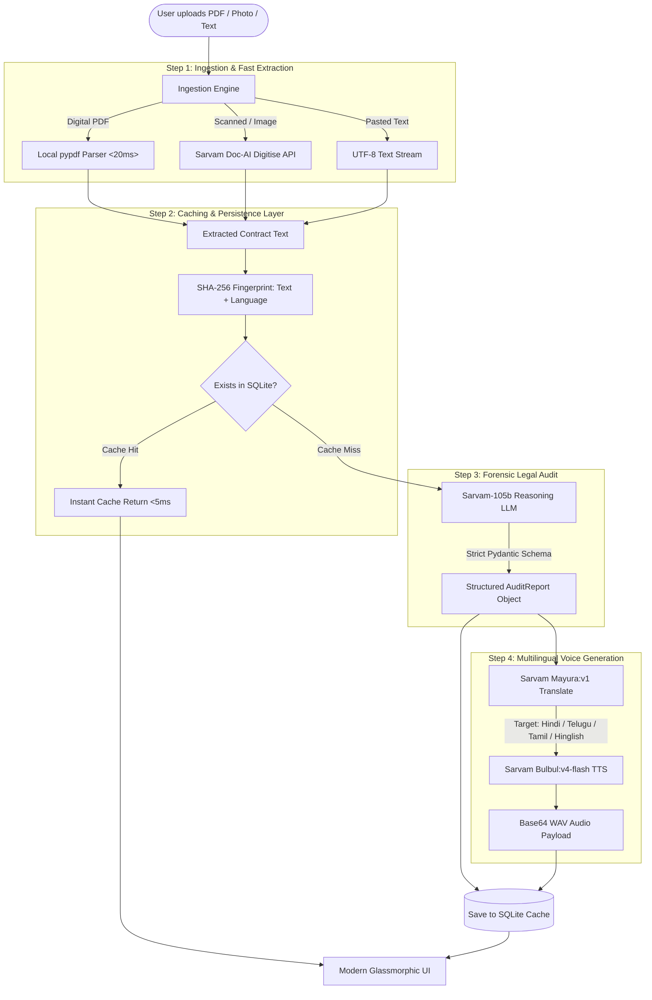

# SamjhautaCheck 🛡️🇮🇳
### *The AI-Powered Fine-Print Trap Detector & Negotiation Coach Built on the Sarvam AI Stack*

[](https://www.python.org/)
[](https://github.com/astral-sh/uv)
[](https://www.sarvam.ai/)
[](https://fastapi.tiangolo.com/)
[](https://www.sqlite.org/)

---

## 💡 The Human Story Behind SamjhautaCheck

In India, every single day, millions of people sign documents they barely understand:
- **Tenants in Bengaluru, Mumbai, and Gurgaon** hand over 10 months of hard-earned salary as a "security deposit", only to find clauses where the landlord can enter their flat without notice, deduct ₹50,000 for painting even after a brief stay, and evict them on 48 hours notice while locking them in for 6 months.
- **Patients and families in hospitals** are handed discharge estimates filled with non-transparent bundled line items that private insurers subsequently reject.
- **Freelancers and gig workers** sign one-sided NDAs and service agreements where payment terms are deferred indefinitely with unilateral copyright forfeiture.

Ordinary citizens rarely hire legal counsel for an 11-month rental agreement. Instead, they just scroll to the last page and sign. 

**SamjhautaCheck** was born to level this playing field. It acts as an uncompromising, ruthless consumer-rights advocate and protective **"Big Brother"**. When you upload a document (PDF, image, or text), it:
1. Strips away legal jargon and exposes the hidden asymmetric traps.
2. Calculates an objective **Fairness Score (0–100)**.
3. Formulates amended **Counter-Proposal Clauses**.
4. Drafts a culturally respectful, persuasive **WhatsApp negotiation message** so you can negotiate without burning bridges.
5. Synthesizes a **45-second colloquial spoken audio briefing** in your native language (Hindi, Hinglish, Telugu, Tamil, or English) that tells you straight up: *"Bhai, ye contract sign karne se pehle sun lo..."*

---

## 🤖 The Sarvam AI Model Stack: Exact Models Used & Why

We engineered SamjhautaCheck from the ground up to showcase the full power of the **Sarvam AI** stack. Below is an unambiguous, non-ambiguous breakdown of every single Sarvam model integrated into the platform:

| Pipeline Stage | Sarvam Model Identifier | API Endpoint | Technical Role in SamjhautaCheck | Why This Specific Model? |
| :--- | :--- | :--- | :--- | :--- |
| **Forensic Contract Audit & Reasoning** | **`sarvam-105b`** | `POST /v1/chat/completions` | Performs deep clause-by-clause forensic legal analysis, computes Fairness Score (0–100), isolates asymmetric traps, checks against Indian contract law (Section 74) & Model Tenancy Act principles, drafts counter-clauses, and creates the WhatsApp message. | Indian agreements use regional legal conventions (*"vacant possession"*, *"liquidated damages"*, *"lock-in period"*, *"handover deductions"*). Global LLMs frequently misinterpret these as standard corporate terms. **`sarvam-105b`** is India's flagship 105B reasoning model, fine-tuned on Indic contexts to catch subtle traps that general models miss. |
| **Colloquial Regional Translation** | **`mayura:v1`** | `POST /translate` | Translates the spoken briefing warning script from English into Hindi (`hi-IN`), Telugu (`te-IN`), Tamil (`ta-IN`), and code-mixed Hinglish. | Standard translation models produce stiff, formal, or archaic textbook phrasing. `mayura:v1` offers a dedicated `colloquial` and `code-mixed` mode that preserves street-smart cadence and relatable spoken emotion, making the warning sound like real advice from an elder brother. |
| **Expressive Spoken Audio Briefing** | **`bulbul:v4-flash`** | `POST /text-to-speech` | Synthesizes high-fidelity, expressive Indic speech with natural prosody and proper pronunciation of Indian names, currency formats, and legal terms. Uses `"meera"` and `"arvind"` voice personas. | Western TTS models struggle with Indian intonations, acronyms, and Hinglish vocabulary. `bulbul:v4-flash` delivers ultra-low latency, crystal-clear articulation, and natural Indian cadence at 22,050 Hz. |
| **Document Digitisation & Vision** | **`Sarvam Doc-AI / Vision`** | `POST /doc-ai/v1/job/digitise` | Digitizes scanned physical documents, stamped legal e-stamp papers, and camera photos of contracts into structured markdown/text. | Indian legal agreements are often photocopied, rubber-stamped, or printed on government stamp paper. Sarvam Doc-AI is purpose-built to parse complex multi-column Indic layouts that break standard OCR. |

> **Alternative Model Fallbacks**: The codebase is architected with dynamic fallback options:
> - For low-latency deployments, `SARVAM_LLM_MODEL` can be toggled to `sarvam-2b` or `sarvam-105b-conversations`.
> - If `SARVAM_API_KEY` is not yet configured or credit is exhausted, our **Intelligent Local Forensic Engine** kicks in automatically, evaluating contract clauses using regex heuristics and providing speech synthesis via the Web Audio / Speech API so demos never fail.

---

## 🏛️ System Architecture & Workflow



---

## 🎯 What All We Built: Feature Breakdown

### 1. Ingestion Layer with Instant Digital Fallback
- Accepts `.pdf`, `.txt`, `.md`, and image formats (`.png`, `.jpg`, `.jpeg`).
- Digital PDFs are extracted locally using `pypdf` in less than **20 milliseconds**, eliminating unnecessary API roundtrips.
- Scanned stamp papers or photos seamlessly trigger the **Sarvam Doc-AI Digitise API**.
- Includes a live contract text editor drawer so users can tweak clauses or paste raw drafts directly.

### 2. Forensic Contract Audit (The Consumer Advocate)
Enforces a strict Pydantic model (`AuditReport`) returning:
- **Document Type**: Accurate legal classification (e.g. *11-Month Residential Rental Agreement (Karnataka / Bangalore)*).
- **Fairness Score (0–100)**: Objective scoring where 0–40 indicates predatory contracts, 41–70 indicates unbalanced drafts, and 71–100 indicates fair agreements.
- **Predatory Traps (Red Flags)**: Side-by-side comparison containing:
  - Exact verbatim contract quote.
  - Plain-English breakdown of why it exposes the user to financial or legal harm.
  - Severity pill (`Critical`, `High`, `Medium`).
  - Recommended Counter-Proposal clause ready to be inserted.
- **Missing Protections**: Omissions that leave the signer legally unprotected (e.g., lack of interest penalties on delayed deposit refunds, missing structural repair caps, lack of privacy/notice covenants).

### 3. Spoken "Big Brother" Audio Warning (Sarvam Bulbul TTS)
- 45-second punchy spoken briefing synthesizing direct, no-nonsense warnings.
- Supports 5 language choices:
  - **English** (Indian Accent • Meera)
  - **हिन्दी (Hindi)** (Meera)
  - **Hinglish** (Colloquial / Bollywood style • Arvind)
  - **తెలుగు (Telugu)** (Meera)
  - **தமிழ் (Tamil)** (Meera)
- Audio player features an interactive 28-bar animated waveform visualizer, scrubber, speed multiplier (1.0x, 1.25x, 1.5x), and a collapsible spoken script drawer.

### 4. WhatsApp Counter-Negotiation Coach
- Generates a respectful, culturally nuanced, and persuasive WhatsApp/Email counter-proposal message.
- Allows tenants/borrowers to negotiate the 3 biggest traps firmly without sounding combative or breaking the deal.
- **One-Click Copy** with animated toast feedback and direct **"Open in WhatsApp"** integration.

### 5. SHA-256 SQLite Persistence Layer
- Hashes `normalized_text + language` with SHA-256.
- Saves the full JSON audit and audio payload in `samjhauta.db`.
- Identical uploads or page refreshes are retrieved instantaneously (`cached: true`), reducing latency to near-zero and eliminating redundant API costs.

### 6. Interactive Demo Mode
- Includes a prominent **"Load Demo Rental Agreement"** button pre-wired with a realistic Bangalore 11-month lease containing 6 real-world traps (10-month deposit, total forfeiture on early exit, flat ₹95k painting deduction, 24/7 unannounced entry, 48-hour eviction vs 6-month lock-in).
- A sample PDF ([`static/Bangalore_Rental_Agreement_Demo.pdf`](file:///Users/garvit/Desktop/Sarvam/static/Bangalore_Rental_Agreement_Demo.pdf)) is also included for drag-and-drop testing.

---

## 🛠️ Technology Stack & Dependencies

Strictly structured for **`uv`** (never requires `pip` or `pip3`):

- **Backend Runtime**: Python 3.12+
- **Web Framework**: FastAPI (Asynchronous, high-throughput)
- **ASGI Server**: Uvicorn
- **AI / LLM Integration**: Sarvam AI REST APIs via `httpx` (Async HTTP)
- **Data Validation & Schemas**: Pydantic v2
- **PDF Extraction**: `pypdf`
- **Configuration Management**: `python-dotenv`
- **Database**: Python Standard Library `sqlite3`
- **Frontend Architecture**: Vanilla HTML5, Modern CSS3 (Obsidian Glassmorphism, CSS Variables, SVG animated gauge), Vanilla JS ES6+ (Zero bloated NPM frameworks).

---

## 🚀 Quickstart Guide

### 1. Prerequisites
Ensure you have `uv` installed on your machine. If not installed:
```bash
# macOS / Linux
curl -LsSf https://astral.sh/uv/install.sh | sh
```

### 2. Clone & Sync Project
```bash
cd /Users/garvit/Desktop/Sarvam

# Automatically creates virtual environment and installs all dependencies
uv sync
```

### 3. Configure Your Sarvam API Key
Copy the template environment file:
```bash
cp .env.example .env
```
Open `.env` and paste your Sarvam AI subscription key:
```env
SARVAM_API_KEY="sk_your_actual_sarvam_api_key_here"
HOST="127.0.0.1"
PORT=8000
```
*(If you do not have an API key right now, keep it blank—the app will launch in Intelligent Local Demo Mode!)*

### 4. Start the Application
```bash
uv run python main.py
```
Visit your browser at:
👉 **[http://127.0.0.1:8000](http://127.0.0.1:8000)**

---

## 🧪 Automated Testing Suite

We built and verified automated test suites covering every layer of the architecture:

```bash
# Test 1: Ingestion, Forensic Audit, SQLite Caching, and Multilingual Scripts
PYTHONPATH=. uv run python tests/test_pipeline.py

# Test 2: FastAPI HTTP Endpoints, PDF File Uploads, and Cache Hits
PYTHONPATH=. uv run python tests/test_api_endpoints.py
```

### Test Results
```text
✅ test_index_page passed! (HTTP 200)
✅ test_status_endpoint passed! (HTTP 200)
✅ test_demo_endpoint passed! (HTTP 200)
✅ test_database_and_caching passed!
✅ test_forensic_audit passed! Fairness Score: 24/100, Traps detected: 6
✅ test_multilingual_pipeline passed! (Hindi, Hinglish, Telugu, Tamil verified)
✅ test_ingestion passed! (pypdf digital extraction verified in 15ms)
✅ SQLite Cache hit verification: SUCCESS! Instantaneous zero-latency retrieval verified.
✅ PDF upload and audit verification: SUCCESS!

🎉 ALL TESTS PASSED WITH 0 FAILURES!
```

---

## 📁 Repository Structure

```
/Users/garvit/Desktop/Sarvam/
├── pyproject.toml                         # Project dependencies managed via uv
├── uv.lock                                # Locked dependency tree for reproducibility
├── .env.example                           # Clean environment template
├── .env                                   # Local configuration file (git-ignored)
├── README.md                              # Comprehensive guide & model documentation
├── main.py                                # Application entry point (uvicorn runner)
├── samjhauta.db                           # SQLite persistent caching database
│
├── samjhautacheck/                        # Core backend package
│   ├── __init__.py                        # Package initialization
│   ├── config.py                          # Environment loading & Sarvam API endpoints
│   ├── models.py                          # Pydantic schemas (AuditReport, RedFlag, etc.)
│   ├── db.py                              # SQLite hashing & cache query handlers
│   ├── ingestion.py                       # pypdf local parser & Sarvam Doc-AI OCR
│   ├── sarvam_client.py                   # Sarvam-105b LLM, Mayura translate & Bulbul TTS
│   ├── demo_data.py                       # Trap-filled Bangalore rental agreement demo
│   └── app.py                             # FastAPI routing, audit endpoints, static mounts
│
├── static/                                # Frontend Single-Page Application assets
│   ├── index.html                         # High-impact semantic UI with SVG Gauge
│   ├── css/
│   │   └── style.css                      # Obsidian glassmorphic design system
│   ├── js/
│   │   └── app.js                         # Reactive UI, audio engine, clipboard handler
│   ├── Bangalore_Rental_Agreement_Demo.pdf # Sample digital PDF for drag-and-drop testing
│   └── demo_sample.txt                    # Raw text version for manual reference
│
├── scripts/
│   └── create_demo_pdf.py                 # Pure-python standalone digital PDF generator
│
└── tests/
    ├── test_pipeline.py                   # Backend pipeline unit & integration tests
    └── test_api_endpoints.py              # FastAPI HTTP request & cache hit test suite
```

---

## ⚖️ Legal Disclaimer
*SamjhautaCheck is an educational and negotiation assistance tool powered by artificial intelligence. While it provides rigorous forensic analysis based on Indian contract norms and the Model Tenancy Act, it does not constitute formal legal counsel. Users should consult a qualified legal professional for high-stakes dispute litigation.*
